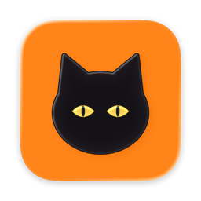
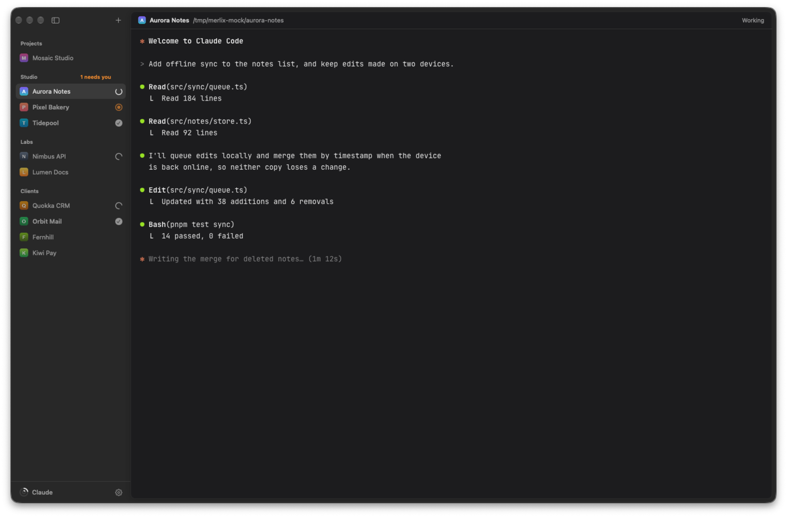

<p align="center">
  
</p>

<h1 align="center">Merlix</h1>

<p align="center">
  Your Claude Code sessions in one native macOS window, grouped by project,<br>
  each with a live status: working, needs you, or done.
</p>

<p align="center">
  
</p>

Merlix is a small, native macOS app (Swift, SwiftUI and AppKit) for people who keep
several Claude Code sessions going at once. Projects sit in a sidebar, each with its
icon and its session's state, so you can see at a glance which one is working, which
one finished, and which one is waiting for you.

Terminals are rendered by [libghostty](https://github.com/ghostty-org/ghostty), so they
are fast, GPU-drawn and use your Ghostty config as is: font, theme, keybindings,
opacity and blur.

It is named after Merlí, a black cat.

## Features

- **Live status per session.** Claude Code reports through hooks: a prompt or a tool
  call means *working*, a permission request or a question means *needs you*, the end
  of a turn means *done*. The Dock badge counts the sessions that need you.
- **Notifications with context.** When a session you are not looking at needs you, the
  notification says what for: the question and its options, the command to run, the
  file to edit.
- **Sessions that pick up where they left off.** Each Claude session keeps its
  conversation id, so reopening Merlix resumes every conversation.
- **Projects and groups.** Groups are collapsible labels; projects and groups reorder by
  drag and drop. Icons come from the project folder (`icon.png`, favicons, an Xcode app
  icon), its GitHub owner, or an initial.
- **Layouts.** A sidebar, tabs across the title bar, or a single focused session.
- **Terminal comforts.** Splits (⌘D, ⇧⌘D), find (⌘F), a command palette (⇧⌘P), file drop,
  secure input at password prompts, and Look Up.
- **Files.** A panel with the project's files (⌥⌘B), kept current as Claude changes them,
  and a small editor with syntax colours from your terminal theme. Files open in the panel
  or in tabs beside the terminal, with line numbers. ⌘-click a path Claude prints to open
  it at that line.
- **Plan usage.** Your Claude 5-hour and weekly usage at the bottom of the sidebar,
  when a status-line usage cache exists at
  `~/.claude/.statusline-usage-cache`.

By default nothing in `~/.claude/settings.json` is changed: Merlix starts each Claude
session with `claude --settings <file>`, and the hooks in that file only exist inside
Merlix. To also follow a `claude` you type by hand in a shell, Settings › Permissions can
install global hooks into `~/.claude/settings.json` (after keeping a dated backup next to
it). They run `~/.merlix/claude-hook.sh`, which does nothing outside Merlix terminals, and
Remove takes out only Merlix's entries.

## Requirements

- macOS 26 or later, Apple silicon
- Xcode with the Metal Toolchain (`xcodebuild -downloadComponent MetalToolchain`)
- [XcodeGen](https://github.com/yonaskolb/XcodeGen)
- [Claude Code](https://code.claude.com) on your `PATH`

Zig is downloaded into `.build/tools` by the build, with its checksum verified; nothing
is installed globally.

## Build

```sh
git clone --recursive https://github.com/criscardozo/merlix.git
cd merlix
make run        # builds GhosttyKit (first time only), generates the project, builds and opens the app
```

`project.yml` signs with the author's team so macOS keeps the app's permissions between
builds. To build it yourself, set `DEVELOPMENT_TEAM` there to your own team, or remove
`DEVELOPMENT_TEAM`, `CODE_SIGN_IDENTITY` and `CODE_SIGN_STYLE` for an ad hoc signature.

| Target | What it does |
|---|---|
| `make build` | Debug build in `.build/xcode` |
| `make run` | Debug build, then open it |
| `make release` | Optimised build in `.build/release/Merlix.app` |
| `make install` | Release build copied to `/Applications` (quit Merlix first) |
| `make project` | Generate `Merlix.xcodeproj` to work in Xcode |
| `make clean` | Remove builds and the generated project |

The first build compiles Ghostty from source and takes a few minutes; later builds reuse
it until the submodule changes.

## Customising

- **Settings (⌘,):** layout, terminal font and size, notifications and Claude Code hooks.
- **Start at launch:** sessions start the first time you open them. Settings › General can
  start them all when Merlix opens, or a single project can from its menu in the sidebar.
- **`~/Library/Application Support/Merlix/ghostty.conf`:** any Ghostty setting, applied to
  Merlix only, on top of your Ghostty config. Reload with ⇧⌘, or from the command palette.

## Layout

| Path | What |
|---|---|
| `apps/macos/App/` | App entry point, menus, notifications |
| `apps/macos/Ghostty/` | The only code that touches the libghostty C API: runtime, surface view, clipboard, secure input |
| `apps/macos/Model/` | Projects, sessions, status rules, the Claude hooks listener and installer, transcripts, project files, syntax colours, icons, usage, persistence |
| `apps/macos/Views/` | Sidebar, terminal card, panes, tabs, files panel and editor, find bar, command palette, settings |
| `apps/macos/Resources/` | The app icon (Icon Composer) |
| `scripts/` | Zig bootstrap, GhosttyKit build, window screenshot |
| `ThirdParty/ghostty` | Ghostty, pinned to a commit on `main` |

Input handling in `TerminalSurfaceView.swift` is a condensed port of Ghostty's own macOS
surface view.

## Licence

MIT, see [LICENSE](LICENSE). Ghostty is also MIT.
